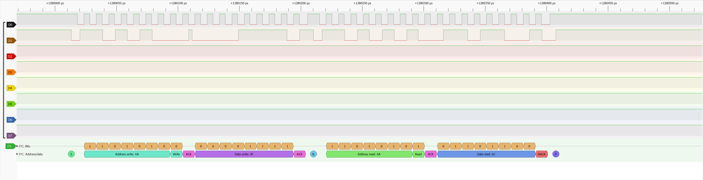

# STM32 Register-Level I2C Sensor Driver

Bare-metal I2C driver for the STM32F446RE (ARM Cortex-M4) that reads two sensors on a shared bus: an LSM6DSOX 6-axis IMU and a BME280 environmental sensor. Readings stream to a PC over UART. The bus traffic was verified with a logic analyzer.

## What it does

- Reads 3-axis acceleration (mg) and angular rate (deg/s) from the LSM6DSOX, and calibrated temperature (°C) from the BME280, about 5 times a second
- Drives the I2C peripheral directly through its control, status, and data registers (`CR1`, `SR1`, `SR2`, `DR`). The HAL only does the one-time clock, pin, and bus-speed setup. Every transfer is handled by my own code.
- Handles start and repeated-start conditions, address phases, ACK/NACK, and stop conditions by hand, with timeouts and error codes so a missing or unresponsive device can't hang the program
- Shares one bus between two devices, selecting each by its 7-bit address (`0x6A` and `0x77`)
- Converts raw sensor data to real units, including Bosch's integer compensation formula, which uses the BME280's factory calibration constants

## Verifying the bus with a logic analyzer

I captured the LSM6DSOX `WHO_AM_I` read (register `0x0F`) with a 24 MHz logic analyzer and decoded it in PulseView:

```
Start → Address write 0x6A → ACK → Register 0x0F → ACK → Repeated start →
Address read 0x6A → ACK → Data 0x6C → NACK → Stop
```



The sensor answers `0x6C`, the ID in its datasheet. The register-level driver produces the same bus traffic as ST's HAL implementation it replaced.

## Sample output

```
LSM6DSOX: err=0, ID=0x6C (expect 0x6C)
BME280:   err=0, ID=0x60 (expect 0x60)
accel (mg):    571     47    826 | gyro (dps):    0    0    0
temp: 24.81 C
```

Lying still, the acceleration vector adds up to about 1000 mg, which is 1 g of gravity.

## Hardware

| Part | Role |
|---|---|
| STM32 Nucleo-F446RE | Microcontroller board (Cortex-M4, built-in ST-LINK debugger) |
| Adafruit LSM6DSOX (#4438) | 6-axis accelerometer + gyroscope, I2C address `0x6A` |
| Adafruit BME280 (#2652) | Temperature / humidity / pressure sensor, I2C address `0x77` |
| 24 MHz 8-channel USB logic analyzer | Bus verification with PulseView |

### Wiring

Both sensors connect in parallel over STEMMA QT cables through a breadboard:

| Signal | Nucleo pin | STM32 pin |
|---|---|---|
| SCL | D15 | PB8 (I2C1_SCL) |
| SDA | D14 | PB9 (I2C1_SDA) |
| Power | 3V3 | — |
| Ground | GND | — |

UART output goes through the ST-LINK virtual COM port (USART2, 115200 baud, 8N1).

## How the driver works

The core functions are in `Core/Src/main.c`:

- `i2c_wait_sr1(flag)` waits for a status flag in `SR1`. It returns an error if the device NACKs (`AF`) or if the flag never shows up (timeout).
- `i2c_write_reg(addr, reg, value)` sends START, the address with the write bit, the register, and the value, then STOP.
- `i2c_read_regs(addr, reg, buf, len)` writes the register address, sends a repeated START, then reads `len` bytes. It ACKs every byte except the last and NACKs the final one before STOP. The single-byte read follows the STM32F4 reference manual's special case.

The IMU's six measurements come back in a single 12-byte read, using the sensor's register auto-increment. Each value is rebuilt from a low and a high byte as a signed 16-bit integer.

## Building

1. Open the project in STM32CubeIDE (it was generated with STM32CubeMX, see `blink.ioc`).
2. Build and flash with **Run**.
3. Open a serial terminal (e.g. PuTTY) on the ST-LINK COM port at 115200 baud, then press reset.

## Next steps

- Move pin and clock setup off the HAL as well, so the driver is fully register-level
- Switch from polling to interrupt- or DMA-driven transfers
- Add humidity and pressure compensation for the BME280
- Compute tilt angles (pitch and roll) from the accelerometer
